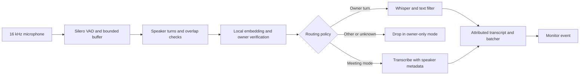

# Recognizing the owner’s voice in DONNA

Research date: 2026-11-16. Scope: web research plus inspection of DONNA’s current code; no microphone recordings, model installations, or performance experiments. Source IDs refer to [sources.md](sources.md). Numerical settings proposed below are experiment starting points, not measured results.

## Recommendation

Add **local, text-independent speaker verification against an explicitly enrolled owner profile**, returning `owner`, `other`, or `unknown`. Keep Whisper for transcription and Silero for detecting speech. They solve different problems. Start by evaluating a WeSpeaker ONNX speaker encoder through sherpa-onnx, with SpeechBrain ECAPA-TDNN as the reference baseline. Use speaker segmentation/diarization for mixed conversations; never assign a whole multi-speaker recording to the owner because its average embedding matches.

This can let DONNA preferentially respond to you and label other people’s speech. It cannot establish that a voice came from a physically present, live person. A recording or clone of your voice may match. Preserve DONNA’s existing distinction between spoken direction and typed authorization.

Recommended default behavior once enabled: only sufficiently confident owner speech reaches the command path. Other/uncertain speech does not become an instruction. An explicit meeting mode may retain other speakers’ words with attribution. Enrollment, thresholds, and model failures must be visible in status rather than silently reverting to treating everybody as you.

## What the terms mean

| Capability | Question answered | Needed here? |
| --- | --- | --- |
| Voice activity detection (VAD) | Is there speech now? | Already present: Silero |
| Speech recognition (ASR) | What words were said? | Already present: whisper.cpp |
| Speaker verification | Does this voice match the enrolled owner? | Core addition |
| Speaker identification | Which enrolled person is this, or none of them? | Optional if multiple profiles are added |
| Speaker diarization | Who spoke when, usually as anonymous speaker IDs? | Needed for reliable mixed conversations |
| Target-speaker extraction | Can the owner’s waveform be separated from overlapping speech? | Later; substantially more complex |
| Anti-spoofing / presentation-attack detection | Is this replayed or synthesized speech? | Separate capability; not implied by verification |
| Addressedness | Is the owner talking to DONNA? | Still needed after identity verification |

A diarization label such as `speaker_0` is not your identity and need not persist between recordings. For this product, the task is one enrolled owner versus an open-ended population of unknown people. Never use a closed-set “pick the closest profile” rule without a rejection threshold. [S1–S6]

## What DONNA does today

Repository findings:

- `plugin/lib/donna_ears/audio.py` / `segmenter.py`: 16 kHz mono capture, 512-sample (32 ms) VAD frames. Segments end on silence or a length cap, not a speaker change. Defaults include 700 ms silence, 250 ms minimum speech and a 28-second cap.
- `listen.py`, `_stt_worker`: concatenates a segment’s frames, transcribes once, filters text, then appends an `Utterance` to the session transcript and batcher. There is no identity gate before either persistence or delivery.
- `batcher.py`, `Utterance`: stores text, times and language, with no speaker metadata. `events.py` prints `[heard ...]` lines and wraps continuations; any identity label must survive wrapping and batching.
- `listen.py`, `_capture`: barge-in currently reacts to VAD, so any nearby speaker can interrupt a reply when the microphone is open. Loudspeaker playback gates capture; identity scoring cannot recover audio that this gate never admitted.
- `protocol.md`: the model infers intent from words and explicitly states that a voice is not an identity. It cannot reliably recover speaker identity from transcript text alone.
- `pyproject.toml`: the listener already uses ONNX Runtime, NumPy and a non-PyTorch Silero package. PyTorch is isolated in the separate voice server. A lightweight ONNX encoder fits this architecture better than importing a full PyTorch diarization stack into every listener.

**Critical implication:** two people can speak back-to-back inside one VAD segment. Accepting its average embedding and forwarding all of its text could turn another person’s sentence into an owner instruction. Speaker changes and overlap require explicit treatment.

## Candidate technologies

| Candidate | Verified capabilities | Fit and tradeoffs |
| --- | --- | --- |
| **WeSpeaker ONNX + sherpa-onnx** | WeSpeaker publishes ONNX models including ResNet34, CAM++ and ECAPA512. sherpa’s example exposes embedding extraction, multiple enrollment recordings, a profile manager and threshold-based unknown rejection. [S1–S3] | Preferred first experiment. Local execution without a PyTorch inference stack. Start with a supported VoxCeleb ResNet34 export; benchmark CAM++/ECAPA alternatives only after confirming extractor compatibility. Runtime package and model preprocessing still add dependencies. |
| **SpeechBrain ECAPA-TDNN** | Ready-made verification using 16 kHz waveforms and cosine similarity; published VoxCeleb recipes and results. [S4, S5] | Strong reproducible baseline. Heavier PyTorch dependency; use an isolated research environment or worker. No Apple Silicon latency claim established here. |
| **pyannote.audio Community-1** | Local speaker diarization; installation needs model-condition acceptance and Hugging Face credentials. [S6] | Best candidate to evaluate for meeting attribution and offline reference annotations. Adds PyTorch/decoding dependencies. The documented file pipeline is not proof of low-latency live behavior. Anonymous clusters still need matching to the enrolled owner. |
| **diart** | Online, overlap-aware diarization; rolling buffer updates every 500 ms, configurable algorithmic latency of 0.5–5 s. [S7] | Useful for continuous speaker changes and overlap. More engineering and model/version dependencies. Published latency settings exclude any guarantee that DONNA’s machine can keep up. |
| **Picovoice Eagle** | Enrollment profiles and real-time local recognition; documented macOS arm64 support and text-independent operation. Requires an AccessKey and internet access for license validation. [S8] | Useful commercial comparison if managed licensing is acceptable. Local audio processing does not mean completely network-independent operation. Pricing and exact deployment rights were not established. |
| **Resemblyzer** | 256-dimensional embeddings, reference-voice matching and continuous-embedding diarization demos. PyTorch; README says it works best on English. [S9] | Simple exploratory baseline. Its small fake-speech demo does not establish resistance to modern cloning or replay. Not the preferred production starting point. |

Library licenses and weight licenses are separate. WeSpeaker, sherpa-onnx and SpeechBrain code use Apache-2.0; pyannote.audio uses MIT. WeSpeaker’s model documentation ties weights to the corresponding dataset license and identifies VoxCeleb as CC BY 4.0. Check the exact artifact’s terms and attribution before shipping it; do not assume the runtime license covers weights. Gated model access is another independent issue. [S1–S6, S13–S15]

An alternative is direct ONNX Runtime inference, reusing DONNA’s existing dependency. This avoids another runtime wrapper but requires reproducing the model’s feature extraction, normalization and tensor layout exactly. A `.onnx` extension does **not** imply that the input is raw waveform. Prefer a supported extractor first, then consider reducing dependencies with embedding-parity tests. [S2, S3]

Cloud diarization alone would still not name the owner. It would also change DONNA’s current local-audio privacy promise. pyannote’s upstream README explicitly distinguishes local Community-1 from server-side Precision-2 and points to commercial voiceprinting. Deepgram and Azure documentation could not be inspected through this environment’s firewall, so no current feature, availability or pricing claims about those services inform this recommendation. [S6]

## How enrollment and matching work

Use a pretrained speaker encoder; training a neural network on your voice is unnecessary. Enrollment creates a small biometric template in the encoder’s embedding space.

1. Start enrollment explicitly from a trusted local interaction. Do not learn “the owner” from whoever speaks first in a session.
2. Gather several clean, varied utterances. An initial experiment could use 30–60 seconds of usable speech across 6–10 utterances, then add a second recording session. These are proposed collection targets, not universal model requirements.
3. Cover the languages, speaking styles and microphones actually used. If English and Portuguese are both used, include both and test cross-language matching; text independence is not a guarantee of language invariance.
4. Reject silence, clipping, substantial overlap and poor recordings. Keep contiguous clean speech regions; do not indiscriminately splice isolated VAD frames together.
5. Encode each accepted utterance with identical preprocessing, L2-normalize its vector, inspect inconsistent samples, then form a normalized centroid. Retain a few separate templates only if evaluation shows a benefit.
6. Validate on held-out owner speech and consenting non-owner speech before enabling owner-only routing. Enrollment agreement alone cannot calibrate false acceptance.

For normalized owner template `c` and normalized candidate embedding `e`, a basic score is:

```text
c = normalize(mean(normalize(encoder(enrollment_i))))
s = dot(normalize(encoder(candidate)), c)

poor quality / too short / overlap / model error -> unknown
s >= calibrated_accept_threshold              -> owner
s <= calibrated_reject_threshold              -> other
otherwise                                     -> unknown
```

A cosine score is not “probability this is Pedro.” SpeechBrain’s API defaults to 0.25 while sherpa’s example defaults to 0.6; they are examples for different systems, not competing universal recommendations. Recalibrate when the model, preprocessing, enrollment aggregation or microphones change. If scoring against multiple templates with a maximum, recalibrate that exact rule: extra chances to match can increase false accepts. [S3, S5]

Do not silently update enrollment from accepted ambient audio. Occasional false accepts could gradually contaminate the owner template. Make re-enrollment explicit and reversible.

## Streaming, short replies, and mixed speakers

For a first prototype, score completed single-speaker utterances. This fits the existing queue but must be presented as a constrained prototype, not reliable room-wide diarization.

For the intended experience, maintain a bounded audio buffer and compute speaker decisions over rolling speech windows, then segment turns before emitting text. A starting experiment is 1.5–3 seconds of clean speech per identity window with a 250–500 ms hop. Those values balance evidence against delay and must be measured; a VAD decision on a 32 ms frame contains far less evidence than reliable identity matching typically needs.

Use speaker-change detection or an online diarization pipeline, then verify clean regions within each turn. Mixed or inconsistent windows should become `unknown`, not be smoothed into `owner`. Reset continuity on a speaker change, source/device change, long gap, capture reset or lost buffer. Do not carry the last owner label indefinitely.

A standalone “yes,” “no,” or “stop” may not contain enough evidence. Options are to ask for a longer repeat, accept a typed input, or keep a separately designed low-risk stop action available to any speaker. Recent owner context may inform a tentative label, but must not automatically turn the next person’s brief reply into owner speech.

Two people talking simultaneously is harder than consecutive turns. An embedding of the mixture is not a trustworthy identity for every word. Prefer abstention for command routing. In meeting mode label overlap explicitly; reliable individual transcripts may require source separation or separate microphones. Diarization timestamps alone do not unmix the words.

Whisper text must be aligned to the verified turn. Either transcribe the separated, non-overlapping turn audio with sufficient boundary context, or add timestamped ASR output and reconcile it with diarization. Do not split a text string by guessing where the second speaker began. Be careful that context audio from an adjacent speaker does not leak into an owner-labeled transcript.

Any later diarization revision must not retroactively authorize text already delivered as a command. Delay command delivery until identity is final enough for the selected policy. Tentative labels are appropriate for a display, not execution.

## Proposed integration in this repository



ASR and verification can run concurrently to reduce latency, but nothing should be persisted or emitted until the identity policy has resolved. Sequential verification first avoids spending ASR compute on rejected speech.

| Location | Proposed change |
| --- | --- |
| New `speaker.py` | Pure preprocessing/embedding/verification interface with explicit quality and failure outcomes; no microphone ownership |
| New profile storage helper | Versioned templates, model hash, preprocessing version, enrollment metadata and calibrated thresholds; atomic updates |
| `cli.py` / `config.py` | Proposed `ears speaker enroll`, `status`, `forget`; owner-only/meeting/off configuration. These commands do not exist yet. |
| `listen.py` | Queue speaker work outside capture callbacks; route before `Transcript.append` and `Batcher.add`; retain bounded queues and shutdown deadlines |
| `segmenter.py` or separate turn layer | Add speaker-turn boundaries and overlap status without confusing VAD with identity |
| `batcher.py` | Extend `Utterance` with identity state, turn ID and reason; preserve per-turn attribution within batches |
| `events.py` | Render identity on every wrapped continuation; account for existing line/event limits |
| `protocol.md` | Owner match still requires addressedness; other/unknown is never a command; preserve typed authorization requirement |
| README privacy/settings | Explain opt-in biometric persistence, deletion and selected routing mode |

A proposed event is `[heard 22:41:07 speaker=owner] ...`; `speaker=other`, `speaker=unknown`, and an overlap reason must remain distinct. Generate those fields from trusted pipeline metadata, never by parsing a speaker name the transcript happens to say. Keep raw similarity scores out of ordinary conversation; they are diagnostics, not confidence percentages.

In owner-only mode, reject before transcript persistence as well as before monitor delivery. Otherwise non-owner speech would still be stored even if the assistant never sees it. In meeting mode, session-local anonymous speaker labels are enough; avoid creating persistent biometric profiles for bystanders.

Barge-in is a separate product choice. Keeping any-speech interruption is responsive but lets another person stop playback. Owner-only interruption requires enough voice evidence and therefore more delay. Measure that tradeoff separately from command attribution. Continue the existing loudspeaker gate until an echo-cancellation path is independently evaluated; embeddings do not cancel acoustic echo or prove liveness.

## Biometrics, replay and storage

Verification answers “sounds like the enrolled speaker,” not “is live and authorized.” Replay of your actual voice may correctly match your identity template while still being an unwanted command source. A high-quality voice clone is another attack. ASVspoof maintains separate countermeasure and spoof-aware speaker-verification baselines precisely because these are distinct tasks. [S10, S11]

For this personal assistant, retain typed approval for consequential actions. Do not market the feature as a secure login factor. Optional anti-spoofing can later be evaluated on actual replay/clone conditions, but adding a detector is not a guarantee against unseen generators or microphones. Random enrollment prompts help avoid accidental pre-recorded enrollment; they are not sufficient proof against real-time synthesis.

Store only the embeddings and necessary metadata by default, not enrollment WAV files. Embeddings are biometric data, not anonymous hashes. Suggested storage is a private directory under `DONNA_HOME` with directory mode 0700 and files 0600, excluded from Git and ordinary diagnostics. Encryption using a macOS Keychain-protected key is a possible enhancement; local permissions alone are not protection from a compromised user account.

Provide deletion, replacement and explicit migration behavior. New encoder weights can make old templates incompatible, so track model checksum and preprocessing version and require re-enrollment when necessary. Deletion should explain whether backups can retain older copies. Do not send templates or raw audio to the language model.

If pyannote is used, explicitly disable its documented optional telemetry (`PYANNOTE_METRICS_ENABLED=0`) for DONNA’s local-processing configuration and test offline behavior after model provisioning. Model download access and runtime network behavior are separate. [S6]

## Evaluation before choosing a backend

Use consented recorded fixtures; repository instructions prohibit opening the microphone just to test. Synthetic TTS can exercise plumbing and lifecycle, but cannot establish owner-recognition accuracy.

Collect separate enrollment, threshold-development and final test recordings. Split by recording session/day, not random adjacent windows, to avoid leakage. Include multiple non-owner people, especially similar-sounding voices, and unknown people absent from development. Test intended microphones and languages, distance, background music, calls, fatigue, whispers, rapid handoffs, overlap, owner recordings through speakers and DONNA’s own TTS.

| Metric | What to report |
| --- | --- |
| False acceptance rate | Fraction of non-owner trials accepted as owner, plus false command deliveries per listening hour |
| False rejection / abstention | Owner trials marked other and owner trials marked unknown separately; successful command coverage |
| ROC/DET and EER | Diagnostic comparisons, not the deployment threshold by themselves |
| Attribution errors | Wrong-speaker words delivered as owner, especially at boundaries and overlap |
| DER for meeting mode | Missed speech, false speech and speaker confusion under a stated overlap/collar scoring protocol |
| Latency | End-of-speech to final identity and to emitted event, p50/p95; separate window accumulation, queueing, inference, ASR and batching |
| Resource use | Cold start, peak RSS, CPU, model size, real-time factor and backlog with Whisper and Kokoro active |
| Spoof acceptance | Replay and cloned-voice acceptance separately from ordinary non-owner false acceptance |

SpeechBrain reports 0.80% EER with score normalization and 0.90% without on a stated VoxCeleb verification setup. These are published recipe results, not DONNA’s expected false-accept rate. pyannote’s published speed table uses an NVIDIA H100; it does not establish laptop performance. Do not compare EER, diarization error rate and vendor similarity scores as if they were the same measurement. [S4, S6]

Choose a threshold based on the false-owner cost, then report the resulting rejection/unknown rate. A possible pilot goal is no false owner command delivery in a prescribed multi-hour mixed-speaker test, while documenting the number of trials and owner coverage; that is a release criterion to negotiate, not a statistical guarantee. With zero false accepts in 1,000 approximately independent non-owner trials, the rough one-sided 95% upper bound is still about 0.3% (the rule of three). Correlated sliding windows do not count as independent trials.

No exact latency, RAM, threshold or accuracy winner is established by this research. Benchmark CPU first on the target Mac; Core ML/provider support must be verified for the chosen build and model. Preserve a known CPU baseline before introducing accelerated execution.

## Implementation sequence and exit criteria

1. **Offline backend comparison:** exact pinned model artifacts, licenses, preprocessing, owner/non-owner corpus and evaluation script. Compare sherpa-supported WeSpeaker ONNX with SpeechBrain ECAPA. Exit with a measured operating point and resource report.
2. **Enrollment and shadow classification:** store an opt-in owner profile; produce private evaluation metadata without changing live routing. No ambient self-enrollment. Exit after held-out session/device validation and template deletion/migration checks.
3. **Owner-only routing:** retain `unknown`; gate transcript persistence and events; preserve lifecycle behavior. Initially declare single-speaker limitations. Exit after mixed-turn tests demonstrate no wholesale owner attribution of mixed segments.
4. **Turn-level conversation support:** add/benchmark online segmentation and overlap handling, identity-to-ASR alignment and per-turn labels. Evaluate diart against a pyannote offline reference rather than assuming either is ground truth.
5. **Optional refinements:** owner-aware barge-in, meeting-mode anonymous speaker tracking, echo cancellation and separately measured anti-spoofing.

Required future tests include: corrupted/missing profile and model fail to unknown; short speech abstains; a speaker change resets identity; an owner segment followed immediately by another speaker never merges their authority; overlap never becomes wholesale owner text; wrapped events preserve attribution; rejected audio never reaches the transcript; queue overload and worker failure do not block microphone shutdown. Changes to `listen.py` must run the repository’s listener/lifecycle tests.

The next concrete step is an offline model bake-off using the owner’s consented recordings. It should determine whether a lightweight local verifier achieves acceptable false-owner behavior before committing DONNA to a heavier diarization runtime.
