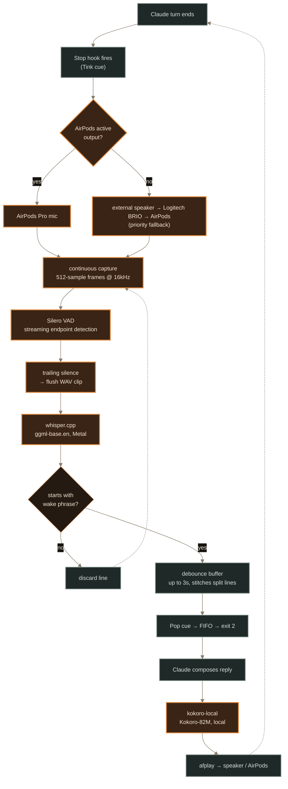

# DONNA — hands-free voice loop for Claude Code

Built 2026-08-15. Lets you talk to Claude Code entirely by voice: no
keyboard, no mouse, mic only. Uses the Deepgram CLI (`dg`) for both
speech-to-text and text-to-speech.

## Signal path

One full cycle of the loop, mic to speaker. Copper stages are the local
STT/TTS engine (Silero VAD + whisper.cpp + kokoro-local, see `PLAN.md`);
slate stages are the wake-word gate, debounce, and Stop-hook wiring
carried over unchanged from the original `dg listen`/`dg speak` build.

Dashed edges close the loop (not this utterance's path); solid edges are
one utterance's journey through the pipeline.

## How it works

1. `voice-listen.sh` runs `dg listen --mic` continuously.
2. **Wake word gate**: a finalized transcript line is only acted on if it
   starts with "Claude" (or "Cloud" — common STT mishearing of the name).
   Everything else is silently ignored, so ambient talk / talking to someone
   else in the room doesn't get treated as a command.
3. **Debounce buffer** (3s, tunable via `DEBOUNCE` in the script): natural
   pauses in speech can make Deepgram finalize a transcript mid-sentence,
   splitting one thought into several lines. After a wake-word line starts a
   command, the script waits up to `DEBOUNCE` seconds for more lines before
   treating the utterance as complete, stitching split sentences back
   together instead of firing on a fragment.
4. Each visual notification (macOS notification via `notify.applescript`)
   and finalized command line is echoed to stdout — one line per utterance.
5. **Superseded design (kept for history):** originally run via the
   `Monitor` tool, with Claude manually stopping/restarting it every turn.
   Replaced with a `Stop` hook (`~/.claude/settings.json`, global — applies
   to every Claude Code session) that runs
   `~/.claude/scripts/voice-stop-hook.sh` via `asyncRewake`: it starts
   `voice-listen.sh` in the background the instant Claude's turn ends
   (doesn't block the turn from finishing), blocks on a FIFO until one
   wake-word-gated command comes through, kills the listener, and exits
   code 2 with the transcript — which wakes Claude back up with it as the
   next turn (prefixed "Voice command captured: "). Claude still composes
   the reply and speaks it manually (`dg speak` + `afplay`) — only the
   listen/rewire step is automated. Since the hook only starts listening
   after Claude's whole turn (including the TTS playback) has finished,
   the anti-feedback turn-taking behavior falls out for free.
   Kill switch: `touch ~/.claude/scripts/.voice-hook-disabled` to turn it
   off (checked at the top of the hook script, absent = enabled by
   default); `rm` it to re-enable. No settings.json edit needed to toggle.

Exiting a voice session: say "Oh my god, Donna, stop" (or "end voice mode") and have
Claude just not act on it / respond without a follow-up question, so the
hook's next cycle has nothing pending — or touch the disable flag above
for a hard stop. There's no built-in infinite-loop cap on the hook itself
(by design, per the user) — it fires again every time a Claude turn ends,
globally, in every session, until the disable flag is set.

## Known limitations (not solved in this build)

- **No barge-in / interruption support.** Strict turn-taking only. The mic
  listener is stopped while Claude's reply plays, both to avoid the
  feedback-loop problem above and because real barge-in (cancel playback the
  moment new speech starts) needs concurrent capture+playback with a cancel
  signal — bigger build than fit in the time available.
- **No true low-latency TTS streaming.** `dg speak` generates the full audio
  file before playback starts; there's no `--stream` flag. `afplay` also
  can't read from stdin (`-` is not a valid source for it — confirmed by
  testing), so even piping wouldn't help. Real streaming would mean hitting
  Deepgram's Aura TTS WebSocket API directly and playing through `ffplay`
  instead of `afplay`.
- **Debounce is a workaround, not a real fix.** The Deepgram CLI (`dg
  listen`) doesn't expose Deepgram's actual endpointing / `utterance_end_ms`
  parameters — checked `--help` and `--agent-friendly` output, neither
  exposes them. If `dg` adds that later, prefer it over the debounce hack.
- 3s debounce was picked empirically after 1.5s cut off mid-sentence during
  testing. May need further tuning per person's speech pace/pause habits.

## Files here

- `voice-listen.sh` lives only at `~/.claude/scripts/voice-listen.sh` (what
  the Stop hook actually runs) — no project-local copy, after the two drifted
  out of sync once already (wake phrase changed in canonical, not here)
- `notify.applescript` — macOS notification helper, takes transcript text as
  argv so it never has to be escaped into an AppleScript string literal

## Also fixed this session (separate from the voice loop, but same session)

`~/.codex/config.toml`'s `elevenlabs` MCP server entry was broken — Bitwarden
CLI (`bw`) was fully logged out, and Codex spawns MCP servers with no
inherited terminal session so it can never interactively unlock it. Fixed by
pointing the entry at `~/.mcp/elevenlabs/launch.sh`, which reads a cached
Bitwarden session token from `~/.mcp/elevenlabs/.bw_session` (never the
master password) — see that script for the one-time manual `bw login` /
`bw unlock --raw` setup it depends on.

Mid-fix, a concurrent Codex session (same `~/.codex/config.toml`) briefly
overwrote that block with a version that popped a fake "Codex" dialog asking
for the Bitwarden master password via `osascript` — turned out to be a
different Codex session working the same file, not a compromise, but worth
remembering: don't type a vault master password into any dialog like that,
regardless of source.
